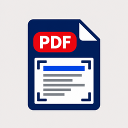

# WordPress.org directory artwork

The selected icon represents a PDF and a preview of a text document. It was created with the built-in OpenAI image generation tool and selected by the project owner from three proposals. It uses generic document shapes and the format label PDF.

## Files and license

- `icon-128x128.png`: normal directory icon, 128 × 128 pixels.
- `icon-256x256.png`: high-density directory icon, 256 × 256 pixels.
- `source/icon-source.png`: original generated raster source, retained for future exports.

The supplied artwork is distributed under GPL-3.0-or-later; see the project's [LICENSE](../LICENSE). It is separate from the runtime placeholder images and is excluded from the installable plugin ZIP by `scripts/package.py`.

## Publishing after directory approval

Copy **only the two `icon-*.png` files** into the top-level `assets/` directory of the plugin's assigned WordPress.org SVN repository, alongside `trunk/` and `tags/`. Do not put directory icons in `trunk/assets/`. Keep their exact filenames, dimensions and PNG format. Set their SVN MIME type to `image/png` before committing. This Git folder prepares the artwork; publishing a GitHub release does not upload it to WordPress.org.

Official requirements: https://developer.wordpress.org/plugins/wordpress-org/plugin-assets/#plugin-icons

The PNG exports use ImageMagick Lanczos resampling, metadata stripping and PNG compression level 9. No creative edits were made during export.

## Generation prompt

Built-in tool: `image_gen.imagegen`, new image, opaque background. The complete prompt for the selected third proposal was:

> Use case: logo-brand. Create ONE original polished square WordPress plugin icon for PDF Thumbnail Inserter. This is option 3, a minimal single-document concept. On a clean full-bleed light warm-gray square background, show one bold dark-blue upright document silhouette with a neatly folded upper-right corner. Inside its top half place a small vivid red capsule with the exact clear text 'PDF' in white. In the document's lower half, show a bright white miniature document preview panel, framed by thick dark-blue crop/insertion corner brackets. This white preview contains a single blue heading bar and five neat horizontal gray typographic placeholder lines of varying lengths. The preview must represent TEXT, not an image. Add one tiny red insertion arrow only if it stays very simple and legible. Distinctive graphic mark, strictly flat vector-like treatment, precise geometry, generous negative space, no 3D rendering, no gradients, readable at 128x128 pixels. Center emblem with safe margin. No outer app frame, no mockup, no watermark, no other lettering, no landscapes, mountains, sun, photo or picture pictogram, no Adobe or WordPress logos. One high-resolution 1:1 opaque square icon.
