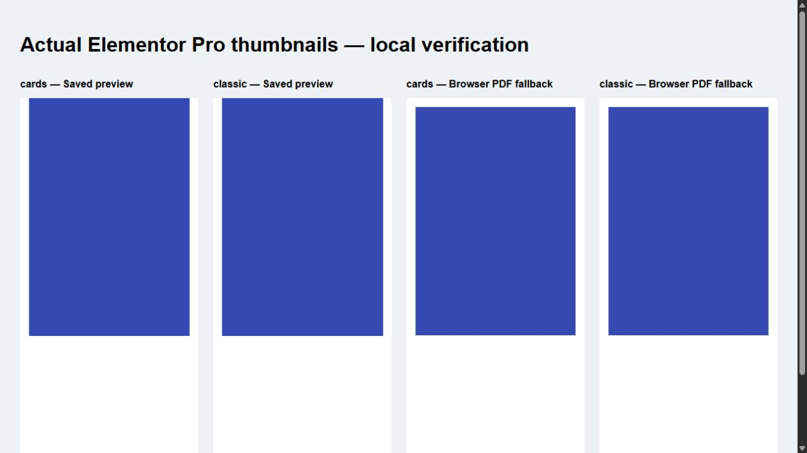

# Elementor Posts PDF thumbnails — 2.01.03

## Problem and cause

A published post containing a PDF shortcode had no stored featured image. Its existing core PDF preview rendered correctly inside the post, but its Elementor Pro Posts/Cards listing emitted no thumbnail element at all. The plugin's virtual featured ID correctly referred to the PDF attachment. Elementor's image control discards IDs whose attachments are not images, then has no image URL to render. This route bypasses the core featured-image HTML filter. The earlier integration tests did not cover this built-in Posts skin route.

The upstream type check and extension filter are visible in [Elementor 4.4.1 image-size.php](https://github.com/elementor/elementor/blob/4.4.1/includes/controls/groups/image-size.php#L95). An isolated WordPress 7.1.5 / PHP 8.2.30 / Elementor and Pro 4.4.1 reproduction using the actual published 2.01.02 ZIP and a real Imagick/core-generated preview confirms missing media in all six built-in Posts/Archive Posts skins. [Baseline reproduction](evidence/elementor-2.01.03/baseline-reproduction.json).

## Correction

- `includes/class-elementor.php::filter_posts_thumbnail_html()` uses Elementor's image HTML filter for the six built-in skin thumbnail controls. It supplies a missing existing preview URL or the plugin's browser PDF renderer. It preserves nonempty image output, explicit URLs/other attachment selections, real featured images, plugin listing scope and the existing fallback toggle. No featured-image metadata is assigned and no previews are generated during rendering.
- `includes/class-plugin.php` wires the viewer dependency and registers one internal component callback. The existing 54 public signatures and original 45 ordered registrations remain intact; the architecture contract explicitly verifies the one additional callback.
- `assets/js/pdf-thumbnail-preview.js` creates a canvas when Elementor Classic's normal `wp_kses_post()` sanitization has removed it. KSES stays enabled. The existing local decoder, resource bounds and cleanup remain in use.
- `tests/elementor-posts-wordpress.php` executes the real image API and protected thumbnail renderer of Cards, Classic, Full Content and their three Archive variants, with correctly attached real widget parents and their actual controls. No Elementor classes are mocked. The Node renderer regression additionally verifies canvas recreation and worker disposal.

## Executed verification

- **33 actual Elementor Pro skin assertions:** real core preview, all six skins, repeated widgets, all six image-off controls, existing extension output, unrelated controls, explicit media choices, requested existing image size, real featured image precedence, no-PDF posts, disabled fallback, single-post exclusion, browser-only fallback and unchanged metadata/files.
- Browser: actual Cards/Classic output exported to a standalone loopback page with the installed Elementor CSS, a real generated JPEG and the real bundled PDF.js renderer. All four combinations (saved image/browser-only, Cards/Classic) visibly render. This was a synthetic local media/layout check, not a full Faun-theme/live-site visual check.
- Entire WordPress native matrix repeated on the final ZIP: **1,114 assertions** across WordPress 6.0/PHP 7.4.27 and WordPress 7.1.5/PHP 8.2.30, without/with Imagick. Real HTTP/concurrency/maintenance/translation/lookup regressions and all six Node suites pass.
- New clean WordPress 7.1.5 sites pass **59 fresh lifecycle** and **56 actual published-2.01.02 upgrade assertions**, retaining settings/media/content. Official core checksums pass.
- **65 syntax checks**, PHPStan level 5: 0 findings; seven negative argument probes still reject invalid inputs. PHPCompatibilityWP 7.4–8.4: 0 errors / 0 warnings.
- **Plugin Check 2.2.0: 0 errors / 0 warnings**, on the exact installed 250-file ZIP, plugin active, 36 default checks including five runtime checks. No new ignores, skips, exclusions or lowered thresholds.
- Reproducible packaging, integrity and byte identity with both installed copies pass. `development.txt`, `readme.txt` and `changelog.txt` are included; README.md, tests, tools, skills and audit evidence are excluded. Gitleaks and private infrastructure/deployment-pattern review are clean.

Commands and complete status records are in [checks.json](evidence/elementor-2.01.03/checks.json); native assertions, lifecycle phases, syntax/analysis output, Plugin Check coverage and the browser scope are in [the evidence directory](evidence/elementor-2.01.03/). Run the new suite with `PTI_TEST_DISPOSABLE=true`, PHP with Imagick enabled, and `tests/elementor-posts-wordpress.php /path/to/local/wordpress`. The environment must be local, have cron disabled and active Elementor/Pro. All database and file fixtures are confined to that disposable installation and cleaned afterward.

## Limits and deployment

The reported live site was only read. It has not been upgraded by this task. The fix must be installed there before the new callback can affect its output; cached page/widget HTML may also need invalidation. Actual integration coverage is Elementor/Pro 4.4.1; no claim is made for every third-party skin or theme. The wider PHP range was checked statically, with 7.4.27 and 8.2.30 actually executed. The prior Gutenberg 7.1 visual iframe exception remains outside this fix.

ZIP SHA-256: `e7980f3a33172a4f7198125ba1185cb858aed869e770cfda113a0b0458abbfd3`. [Manifest](release-manifest-2.01.03.json), [Plugin Check](plugin-check-2.01.03.json), [machine-readable report](elementor-posts-2.01.03.json). The release's `release-verification.json` records the final remote commit, tag and re-downloaded asset comparison.
