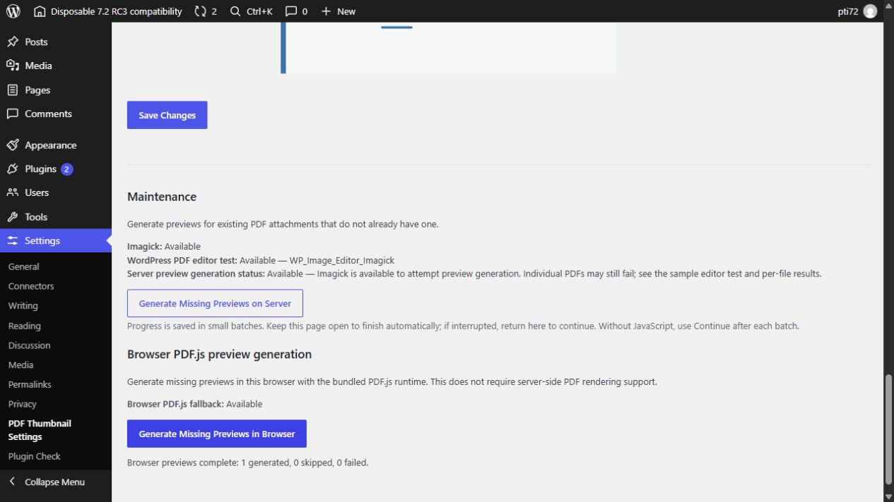

# WordPress 7.2 readiness — tested RC3, 26 November 2026

The unchanged published PDF Thumbnail Inserter **2.01.04** passes the executed checks on **WordPress 7.2-RC3**. This is an RC compatibility assessment, not a claim of complete acceptance of the final WordPress 7.2 release. Full visual Gutenberg/inspector acceptance remains incomplete because the available embedded browser renders its editor iframe blank, including with this plugin and Elementor inactive.

No plugin runtime, version or `Tested up to` field was changed. No new plugin release was necessary. The existing release remains [2.01.04](https://github.com/orloxgr/PDF-Thumbnail-Inserter/releases/tag/v2.01.04), source commit `27abc29ec824abc2fcc5f656bfb403b89d3398d5`.

## Field-guide comparison

| Area | Application to this plugin | Review/result |
| --- | --- | --- |
| Media client-side processing | PDF upload listeners and browser preview saving | Official media notes keep PDFs on the classic upload path. Existing plupload/Backbone/REST listeners remain applicable. Actual REST upload, authenticated multipart preview saving and browser PDF.js generation/save pass. The new raster-image pipeline itself was not browser-tested. |
| Document isolation / deprecated crossorigin injection | Module script attribute filters and local workers | No calls to the two deprecated isolation functions and no manual crossorigin injection. Filters affect only the plugin's three module handles. Actual script-printing/security-attribute regressions and real browser worker generation pass. |
| Editor components / CSS Modules / DataForm | `wp.components`, `InspectorControls`, media selection and block wrapper | Uses shared core handles, stable component props and scoped `.pti-*` CSS; no bundled WordPress package copies, Emotion selectors, removed experimental grouping or listed deprecated components. API version 3 registration, serialization and native rendering pass. Browser inserter, insertion and draft save pass; canvas/inspector visual controls remain unverified. |
| Admin SVG icons | Settings page and plugin block icon | No admin menu/bar icon override or Dashicons pseudo-element CSS. The plugin's separate document-cover SVG is generated from its own escaped template; native XML and anonymous HTTP resource tests pass. |
| jQuery Migrate | Classic Editor and settings color picker | Uses `.on()` and core `wpColorPicker`; no removed jQuery shorthand/bind/delegate calls. The uploader's `.bind()` belongs to plupload, not jQuery. Existing Node behavior suites and actual settings color-picker initialization pass. No jQuery 4 claim is made; 7.2 updates Migrate. |
| Abilities / Interactivity / REST revisions, comments, CORS | No relevant API usage | No abilities, removed Interactivity directives, revisioned-meta manipulation, comment-status filtering or custom CORS handler. Existing local media REST integration is covered. |
| SQL modes, random routes, miscellaneous core | Prepared queries and scoped query/preview routing | Uses core `wpdb` and no custom SQL-mode override. Actual query budgets, SQL patterns, excerpt routing and anonymous public resources pass. No random-route or obsolete compression-constant dependency. |

Primary references: [Field Guide](https://make.wordpress.org/core/2026/11/20/wordpress-7-2-field-guide/), [Media changes](https://make.wordpress.org/core/2026/11/17/media-changes-in-wordpress-7-2/), [Editor components](https://make.wordpress.org/core/2026/11/10/editor-components-updates-in-wordpress-7-2/), [jQuery preparation](https://make.wordpress.org/core/2026/11/17/preparing-for-jquery-4-with-wordpress-7-2/). The official [RC3 announcement](https://wordpress.org/news/2026/11/wordpress-7-2-release-candidate-3/) schedules final 7.2 for **8 December 2026**.

## Executed evidence

- Official RC3 ZIP downloaded and core checksums verified. Exactly **251 files** installed from the re-downloaded published 2.01.04 ZIP and compared byte-for-byte.
- MariaDB 11.4.12 in a separate disposable database. Native PHP **7.4.27 and 8.2.30**, each without/with Imagick and Ghostscript: **1,118 main native assertions**, plus **62 real WordPress security assertions**. Real lock/deletion concurrency, query, translation, SQL/routing and HTTP suites pass. The HTTP server ran PHP 8.2.30.
- **33 actual Elementor/Pro 4.4.1 skin assertions**, all six Node suites, syntax, PHPStan level 5, seven negative contract probes and PHPCompatibilityWP 7.4–8.4 pass.
- Annotation-free WPCS security/alternative-function rules: **0 errors / 0 warnings**; **0 runtime suppressions**. **Plugin Check 2.2.0: 0 errors / 0 warnings**, exact installed release, all 36 default checks including five correctly initialized runtime checks.
- A fresh RC3 installation passes **59 lifecycle assertions**. A separate WordPress 7.1.5 site with settings, synthetic media and stored content is actually upgraded to RC3 (core files plus database); **56 lifecycle/upgrade assertions** pass with the plugin unchanged and data retained.
- Actual browser PDF.js maintenance: **1 generated, 0 skipped, 0 failed**. A persisted **1200×1800 JPEG** and parent/ownership metadata are verified through real WordPress APIs. This uses the actual browser decoder and multipart save endpoint, not mocks.
- Browser block registration, inserter selection, insertion and draft save succeed. Stored content is `<!-- wp:pdf-thumbnail-inserter/pdf-thumbnail {"columns_widescreen":4} /-->`. Full canvas/inspector UI remains unverified.

## Limits and warnings retained

The embedded browser shows a blank Gutenberg canvas. [Partial insertion/save screenshot](evidence/wordpress-7.2-RC3/editor-partial.png) and [baseline without the plugin or Elementor](evidence/wordpress-7.2-RC3/editor-baseline.png) document the limitation. This is not counted as a visual pass.

The editor console emitted two deprecations when Elementor was active; both disappear with Elementor inactive. One `api-fetch` unused-preload warning remains even with this plugin inactive. [All observed console messages](evidence/wordpress-7.2-RC3/browser-logs.json) and [baseline](evidence/wordpress-7.2-RC3/browser-baseline.json) are retained. No warnings were hidden or suppressed.

The initial SQLite/PHP 7.4 environment failed to bootstrap its database drop-in; the completed matrix uses native MariaDB. A first admin HTTP probe redirected, then passed unchanged on repetition after an ordinary admin visit. The initial public-page probe also received a canonical redirect because fresh core enabled pretty permalinks; the final HTTP fixture explicitly uses plain permalinks, matching the existing suite. These are environment/setup distinctions, not plugin fixes or ignored test failures; all 47 final checks pass.

WGL/full-theme visuals, the new raster-image upload pipeline and every PHP/browser combination were not revalidated. Production sites were not touched. Final 7.2 should be rerun when released, and a functioning Chrome/Edge editor session is still needed to finish visual acceptance before declaring complete readiness or expanding the compatibility metadata.

Commands, assertions and tool outputs: [evidence](evidence/wordpress-7.2-RC3/), [machine-readable assessment](wordpress-7.2-compatibility.json).
